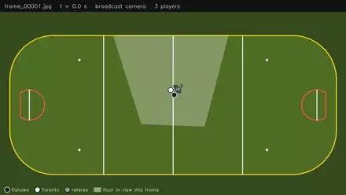
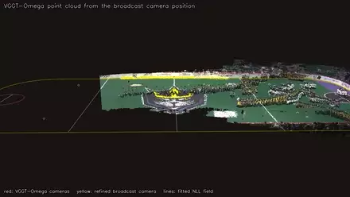
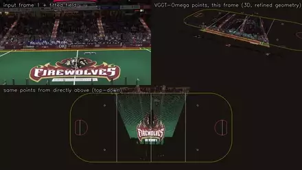
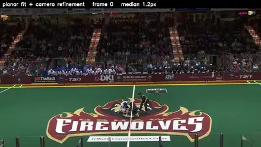

# Lacrosse SAM Tracking

Players of NLL box-lacrosse broadcast clips, tracked on the field and named by jersey number:

- SAM3 segments the players.
- VGGT-Omega reconstructs the cameras and depth.
- The NLL field is fitted to the reconstructed floor plane, and the broadcast camera is refined against it.
- Each player's foot point is mapped onto the field, tracked, and named by the jersey number read from their crops.

There are two clips: 153 s of Week 1 (Toronto at Oshawa) at 10 fps, and 10 s of San Diego at 10 fps.

## Videos

Click a preview to open the full H.264 video.

**Players on the fitted field.** Each player is a circle in their team's colour, placed through that frame's refined camera. The shaded area is the floor the camera sees in that frame. On Week 1, each player whose jersey number was read is labelled with it.

| Week 1, Oshawa | 10 s clip, San Diego |
|---|---|
| [](docs/videos/week1_birds_eye.mp4) | [](docs/videos/clip10s_birds_eye.mp4) |

**VGGT-Omega point cloud on the fitted field.** The orbit ends in a top-down view. Yellow shows the refined broadcast camera, and red shows VGGT-Omega's own cameras.

| Week 1, Oshawa | 10 s clip, San Diego |
|---|---|
| [](docs/videos/week1_orbit.mp4) | [](docs/videos/clip10s_orbit.mp4) |

**Per frame.** Each frame shows the input with the fitted field, that frame's points in 3D, and the same points from above.

| Week 1, Oshawa | 10 s clip, San Diego |
|---|---|
| [](docs/videos/week1_timeline.mp4) | [](docs/videos/clip10s_timeline.mp4) |

**Fitted field drawn on the video.** The full videos show the rigid planar fit (top) and the fit after camera refinement (bottom).

| Week 1, Oshawa | 10 s clip, San Diego |
|---|---|
| [](docs/videos/week1_field_fit.mp4) | [](docs/videos/clip10s_field_fit.mp4) |

## How it works

Week 1 runs in two passes. A **keyframe pass** at 1 fps is checked by eye: its paint labels and its teams. The **full pass** at 10 fps starts from it, so only frames that the automatic checks flag need to be looked at. The 10 s clip is short enough to check in full, so it runs as one pass.

1. **Segmentation and undistortion.** SAM3 text prompts segment `player`, `white lines on green field` and `yellow outline around field border`, in 45-frame chunks. Radial lens distortion is estimated from the straightness of the white lines, and the frames and masks are undistorted.
2. **Reconstruction.** VGGT-Omega predicts per-frame cameras, depth and confidence. Clips longer than 170 frames are reconstructed in overlapping chunks, each mapped into the first chunk's coordinates by the similarity that aligns the frames they share.
3. **Landmark masks** (`build_field_paint_masks.py`). Painted lines, creases and the far board base are detected by colour. Each piece is labeled with its landmark, and the keyframe labels are checked by eye (corrections in `data/field_label_review/`). Close-up shots from other cameras (a player at least 45% of the image tall for 5 frames or more) get no landmarks.
4. **Field fit** (`fit_field_plane_landmarks.py`).
   - A plane is fitted to VGGT-Omega's floor points.
   - Landmark pixels are lifted onto that plane by ray–plane intersection.
   - A rigid similarity maps the plane to the NLL rulebook field (`field_model.py`).
   - The camera is then refined: one shared camera position, per-frame pan, tilt, roll and zoom, and the arena's corner radius.
   - Background points tracked between neighbouring frames tie each frame's camera to the measured image motion.
   - At 10 fps, every frame starts from the keyframe cameras (`propagate_field_cameras.py`). Only keyframes with at least two painted lines are anchors, because one line plus the boards lets the camera slide along the floor; the frames between are reached through the tracked motion.
   - `camera_motion_check` in the fit summary lists frames where the fitted camera disagrees with that motion by more than 5 px. If any remain, the cameras are refined once more with the tracked motion trusted further.
   - Median reprojection error is 1.7 px on Week 1 at 10 fps and 2.9 px on the 10 s clip.
   - [docs/field_plane_fit.md](docs/field_plane_fit.md) gives the method and the evidence.
5. **3D renders** (`render_vggt_scene_3d.py`). VGGT-Omega's points are placed through the refined cameras, so the floor paint lands on the fitted lines.
6. **Players on the field.**
   - At 10 fps, SAM3 tracks are joined across its 45-frame chunks (`link_sam3_chunk_tracks.py`).
   - Teams come from jersey brightness (`classify_sam3_teams_by_torso_color.py`), with per-track corrections checked by eye in `data/team_review/`. At 10 fps, the checked keyframe teams carry over to each track by mask overlap on the shared frames (`transfer_team_labels.py`).
   - `render_field_birds_eye.py` maps each player's foot point through that frame's homography in `field_homographies.json`. The foot point is the lowest row of the mask at the median column of its lower half, so it does not swing from foot to foot with each stride. Close-ups and other cuts give no positions.
   - `field_player_tracks.py` turns the foot points into smoothed tracks on the field:
     - Each foot point is weighted by its uncertainty in feet, from a few pixels of foot-point noise and the homography's local scale. Partly hidden players count less: feet behind another player, or a mask cut by the side of the image.
     - A constant-velocity Kalman filter drops outliers and whole frames where SAM3 shifted IDs between players. A track is split where SAM3 moved its ID to another player, confirmed over 0.3 s.
     - The pieces are rejoined one-to-one by team and motion across gaps of up to 1 s. A smoother then fills those gaps.
     - On Week 1, this takes the frame-to-frame wobble of a player's position from 0.56 ft to 0.07 ft (median). The 350 SAM3 tracks become 153 field tracks.
7. **Jersey numbers.** Numbers are read per segment (one SAM3 ID within one field track), not per frame:
   - `jersey_number_sheets.py` picks up to 6 frames per segment, spread over time so some show the player's back. It crops the upper body, dims everything outside the player's mask, and packs 50 numbered tiles into each sheet. That's about 18 image tokens per crop.
   - Claude Code opens each sheet in a session (no API) and records, per crop, only the numbers it can read with certainty, plus the crops that show a striped official. The reads are stored by crop ID in `data/jersey_number_review/`.
   - `combine_jersey_numbers.py` gives each segment its most-read number. A field track carries a number when its segments agree on one and no other track of its team has that number at the same time. Tracks with the same team and number are one player. It lists the conflicts: two numbers in one segment or track, one number in two places at once, and referees inside team tracks.
   - `render_field_birds_eye.py --jersey-reads` labels each dot with its track's number. Dots of unread or conflicting tracks have no label.
8. **Meshes** (optional). SAM-Body4D fits a body mesh to every player box. `render_sam_body4d_on_field.py` and `view_vggt_reconstruction.py` place the meshes on VGGT-Omega's depth and map them onto the field with the rigid planar fit.

## Setup

```bash
python -m pip install torch numpy scipy scikit-image opencv-python pillow imageio imageio-ffmpeg \
  transformers accelerate trimesh viser omegaconf tqdm
git clone https://github.com/facebookresearch/vggt-omega third_party/vggt_omega
python -m pip install -r third_party/vggt_omega/requirements.txt
export HF_TOKEN='your_huggingface_token'   # SAM3; never commit it
# for the meshes only
git clone https://github.com/facebookresearch/vggt third_party/VGGT
git clone https://github.com/gaomingqi/sam-body4d third_party/sam-body4d
python -m pip install -e third_party/sam-body4d
```

- **Checkpoint.** Put `vggt_omega_1b_512.pt` (gated, Hugging Face `facebook/VGGT-Omega`) under `checkpoints/vggt_omega/`.
- **Untracked files.** Source videos, frames, checkpoints, `third_party/` and `outputs/` stay local and are not tracked.
- **Import errors.** If Transformers fails to import because of `kernels`, run `pip uninstall -y kernels kernels-data`.

## Run

Week 1 runs from the segment 08:20–10:53 of the game video. The 10 fps frames are sampled 0.05 s later than the 1 fps frames, so every 10th frame (from frame 5) is the same image as a keyframe.

```bash
export VIDEO="data/Week 1/112825_osh_tor.mp4"
export KEY_RAW=data/week1_112825_osh_tor_0820_1053_frames_1fps KEY_FRAMES=data/week1_112825_osh_tor_0820_1053_frames_1fps_undistorted
export KEY_RAW_SAM3=outputs/sam3/week1_112825_osh_tor_0820_1053_1fps KEY_SAM3=outputs/sam3/week1_112825_osh_tor_0820_1053_1fps_undistorted
export KEY=outputs/vggt_omega/week1_1fps_undistorted
export RAW=data/week1_112825_osh_tor_0820_1053_frames_10fps FRAMES=data/week1_112825_osh_tor_0820_1053_frames_10fps_undistorted
export RAW_SAM3=outputs/sam3/week1_112825_osh_tor_0820_1053_10fps SAM3=outputs/sam3/week1_112825_osh_tor_0820_1053_10fps_undistorted
export RUN=outputs/vggt_omega/week1_10fps_undistorted
KEYS="--keyframe-offset 5 --keyframe-stride 10"
```

**Keyframe pass (1 fps, 153 frames).**

```bash
# frames and SAM3 masks (white lines for the lens, yellow outline for bootstrapping labels on a new clip)
mkdir -p "$KEY_RAW"
ffmpeg -ss 00:08:20 -to 00:10:53 -i "$VIDEO" -vf fps=1 "$KEY_RAW/frame_%05d.jpg"
for prompt in player 'white lines on green field' 'yellow outline around field border'; do
  name=$(echo "$prompt" | cut -d' ' -f1-2 | tr ' ' '_')
  python scripts/run_sam3_text_chunked.py --frames-dir "$KEY_RAW" --text "$prompt" --fps 1 \
    --output "$KEY_RAW_SAM3/${name}_tracks_chunked.mp4" --mask-dir "$KEY_RAW_SAM3/${name}_label_masks_chunked" \
    --instance-mask-dir "$KEY_RAW_SAM3/${name}_instance_masks_chunked"
done

# lens model from the white lines; frames and masks undistorted; detection boxes from the undistorted masks
python scripts/undistort_clip_from_text_line_masks.py --frames-dir "$KEY_RAW" \
  --white-mask-dir "$KEY_RAW_SAM3/white_lines_instance_masks_chunked" --output-frames-dir "$KEY_FRAMES" \
  --calibration-json "$KEY/lens_undistortion.json" \
  $(for n in player white_lines yellow_outline; do echo --npz-mask-map "$KEY_RAW_SAM3/${n}_instance_masks_chunked:$KEY_SAM3/${n}_instance_masks_chunked"; done)
python scripts/rebox_sam3_json_from_instance_masks.py --source-json "$KEY_RAW_SAM3/player_tracks_chunked.json" \
  --instance-mask-dir "$KEY_SAM3/player_instance_masks_chunked" --frames-dir "$KEY_FRAMES" \
  --output-json "$KEY_SAM3/player_tracks_chunked_reboxed.json"

# VGGT-Omega (about 45 s and 19 GB of GPU memory)
python scripts/run_vggt_omega_clip.py --frames-dir "$KEY_FRAMES" --output "$KEY/vggt_omega_predictions.npz"

# landmark masks (labels proposed from a fit of the clip, then the checked review) and the field fit
python scripts/build_field_paint_masks.py --frames-dir "$KEY_FRAMES" --predictions "$KEY/vggt_omega_predictions.npz" \
  --player-mask-dir "$KEY_SAM3/player_instance_masks_chunked" --fit "$KEY/field_fit/field_plane_fit.json" \
  --review data/field_label_review/week1_1fps_undistorted.json --output-dir "$KEY/paint_masks"
python scripts/fit_field_plane_landmarks.py --predictions "$KEY/vggt_omega_predictions.npz" --frames-dir "$KEY_FRAMES" \
  --paint-masks "$KEY/paint_masks" --fps 1 --output-dir "$KEY/field_fit"

# teams: jersey brightness plus the checked review
python scripts/classify_sam3_teams_by_torso_color.py --review data/team_review/week1_1fps_undistorted.json \
  --frames-dir "$KEY_FRAMES" --sam3-json "$KEY_SAM3/player_tracks_chunked_reboxed.json" \
  --instance-mask-dir "$KEY_SAM3/player_instance_masks_chunked" \
  --output-json "$KEY/teams/teams.json" --output-video "$KEY/teams/teams_review_h264.mp4" --fps 1
```

To review the paint labels, look through `$KEY/paint_masks/review/sheet_*.jpg`; [docs/field_plane_fit.md](docs/field_plane_fit.md) explains the corrections and how to bootstrap labels on a new clip. To review the teams, look at one crop per SAM3 track and write the corrections (`black`, `white`, `referee`, or `ignore` for the bench and stands) to the review JSON, keyed by object id.

**Full pass (10 fps, 1,530 frames).**

```bash
# frames, SAM3 players, the keyframe lens model, SAM3 tracks joined across chunks
mkdir -p "$RAW"
ffmpeg -ss 00:08:20 -to 00:10:53 -i "$VIDEO" -vf "setpts=PTS+0.05/TB,fps=10" -q:v 2 -frames:v 1530 "$RAW/frame_%05d.jpg"
python scripts/run_sam3_text_chunked.py --frames-dir "$RAW" --text player --fps 10 --output "$RAW_SAM3/player_tracks_chunked.mp4" \
  --mask-dir "$RAW_SAM3/player_label_masks_chunked" --instance-mask-dir "$RAW_SAM3/player_instance_masks_chunked"
python scripts/undistort_clip_from_text_line_masks.py --frames-dir "$RAW" --output-frames-dir "$FRAMES" \
  --reuse-calibration "$KEY/lens_undistortion.json" --calibration-json "$RUN/lens_undistortion.json" \
  --npz-mask-map "$RAW_SAM3/player_instance_masks_chunked:$SAM3/player_instance_masks_chunked"
python scripts/rebox_sam3_json_from_instance_masks.py --source-json "$RAW_SAM3/player_tracks_chunked.json" \
  --instance-mask-dir "$SAM3/player_instance_masks_chunked" --frames-dir "$FRAMES" --output-json "$SAM3/player_tracks_chunked_reboxed.json"
python scripts/link_sam3_chunk_tracks.py --sam3-json "$SAM3/player_tracks_chunked_reboxed.json" \
  --instance-mask-dir "$SAM3/player_instance_masks_chunked" --frames-dir "$FRAMES" \
  --keyframe-teams "$KEY/teams/teams.json" --keyframe-mask-dir "$KEY_SAM3/player_instance_masks_chunked" $KEYS \
  --output-json "$SAM3/player_tracks_linked.json" --output-mask-dir "$SAM3/player_instance_masks_linked"

# VGGT-Omega in chunks (about 10 min, 20 GB), keyframe cameras carried through the tracked motion, landmarks, field fit (about 40 min)
python scripts/run_vggt_omega_clip.py --frames-dir "$FRAMES" --output "$RUN/vggt_omega_predictions.npz"
(cd scripts && python propagate_field_cameras.py --keyframe-fit "../$KEY/field_fit/field_plane_fit.json" --keyframe-masks "../$KEY/paint_masks/masks" \
  --frames-dir "../$FRAMES" $KEYS --output-json "../$RUN/propagated_cameras.json")
python scripts/build_field_paint_masks.py --frames-dir "$FRAMES" --player-mask-dir "$SAM3/player_instance_masks_linked" \
  --fit "$RUN/propagated_cameras.json" --checked-masks "$KEY/paint_masks/masks" $KEYS --output-dir "$RUN/paint_masks"
python scripts/fit_field_plane_landmarks.py --predictions "$RUN/vggt_omega_predictions.npz" --frames-dir "$FRAMES" \
  --paint-masks "$RUN/paint_masks" --seed-cameras "$RUN/propagated_cameras.json" --fps 10 --output-dir "$RUN/field_fit"

# 3D videos
python scripts/render_vggt_scene_3d.py --predictions "$RUN/vggt_omega_predictions.npz" --field-fit "$RUN/field_fit/field_plane_fit.json" \
  --frames-dir "$FRAMES" --output-dir "$RUN/scene_3d" --points-per-frame 2500 --timeline-fps 10

# teams from the checked keyframes (tracks they leave open are checked by eye in the same review file), then the bird's-eye
(cd scripts && python transfer_team_labels.py --sam3-json "../$SAM3/player_tracks_linked.json" --instance-mask-dir "../$SAM3/player_instance_masks_linked" \
  --keyframe-teams "../$KEY/teams/teams.json" --keyframe-mask-dir "../$KEY_SAM3/player_instance_masks_chunked" \
  $KEYS --output-review ../data/team_review/week1_10fps_undistorted.json)
python scripts/classify_sam3_teams_by_torso_color.py --review data/team_review/week1_10fps_undistorted.json \
  --frames-dir "$FRAMES" --sam3-json "$SAM3/player_tracks_linked.json" --instance-mask-dir "$SAM3/player_instance_masks_linked" \
  --output-json "$RUN/teams/teams.json" --output-video "$RUN/teams/teams_review_h264.mp4" --fps 10
BIRDS_EYE="--homographies $RUN/field_fit/field_homographies.json --sam3-json $RUN/teams/teams.json \
  --instance-mask-dir $SAM3/player_instance_masks_linked --frames-dir $FRAMES --output-video $RUN/birds_eye/birds_eye_players_h264.mp4 \
  --output-json $RUN/birds_eye/birds_eye_players.json --fps 10 --team-names black=Oshawa,white=Toronto"
python scripts/render_field_birds_eye.py $BIRDS_EYE

# jersey numbers: contact sheets, read by Claude Code in a session, combined; then the bird's-eye labelled with them
python scripts/jersey_number_sheets.py --birds-eye-json "$RUN/birds_eye/birds_eye_players.json" \
  --instance-mask-dir "$SAM3/player_instance_masks_linked" --frames-dir "$FRAMES" --output-dir "$RUN/jersey_numbers"
# Claude Code opens $RUN/jersey_numbers/sheets/*.png and records the reads by crop id in the reads file
python scripts/combine_jersey_numbers.py --reads data/jersey_number_review/week1_10fps_undistorted_reads.json \
  --birds-eye-json "$RUN/birds_eye/birds_eye_players.json" --labels data/jersey_number_review/week1_10fps_undistorted.json \
  --output-json "$RUN/jersey_numbers/players.json"
python scripts/render_field_birds_eye.py $BIRDS_EYE --jersey-reads data/jersey_number_review/week1_10fps_undistorted_reads.json
```

`transfer_team_labels.py` overwrites the review file, so the tracks checked by eye are added after it runs. A track that switches between players is marked `per_detection` and classified frame by frame. The reads are keyed by crop id, so the second bird's-eye has the same tracks as the first.

**Jersey numbers on Week 1.** Claude Code reads the sheets in a session, with no API calls. A conflict is resolved by looking at its crops at 2.5× and correcting the reads file or the team review.

- **Sheets:** 1,164 crops from 194 segments on 24 sheets, with 112 certain numbers and 53 officials.
- **Players:** 21 players (8 Oshawa, 13 Toronto) are named across 35 field tracks. These tracks hold 48% of the team players' dots in the bird's-eye.
- **Labelled set:** 150 crops from 25 random segments, labelled at 2.5× (`data/jersey_number_review/week1_10fps_undistorted.json`). The 1× reads get 11 of the 12 legible numbers right, with no wrong reads and no false reads on the 127 crops without a number. The same reader made both, so this measures what the smaller size loses, not independent accuracy.
- For labelling or checking crops by eye, add `--only-crops <label file> --tile-scale 2.5 --cols 6 --rows 3` to `jersey_number_sheets.py`.

**Meshes (optional, on the keyframes).**

```bash
python scripts/export_vggt_omega_vggt_layout.py --predictions "$KEY/vggt_omega_predictions.npz" \
  --field-fit "$KEY/field_fit/field_plane_fit.json" --frames-dir "$KEY_FRAMES" --output-dir "$KEY/vggt_layout"
PYOPENGL_PLATFORM=egl python scripts/run_sam_body4d_from_sam3_boxes.py --repo-root third_party/sam-body4d \
  --config third_party/sam-body4d/configs/body4d.yaml --frames-dir "$KEY_FRAMES" \
  --sam3-json "$KEY_SAM3/player_tracks_chunked_reboxed.json" --output-dir "$KEY/sam_body4d" \
  --output-video "$KEY/sam_body4d/overlay_h264.mp4" --fps 1
MESHES="--layout-dir $KEY/vggt_layout --frames-dir $KEY_FRAMES --teams-json $KEY/teams/teams.json \
  --mesh-root $KEY/sam_body4d/mesh_4d_individual --focal-root $KEY/sam_body4d/focal_4d_individual --fixed-field-player-size"
python scripts/render_sam_body4d_on_field.py $MESHES --output-dir "$KEY/meshes_on_field" --fps 1 --team-names "black=Oshawa,white=Toronto"
python scripts/view_vggt_reconstruction.py $MESHES --port 8097   # http://127.0.0.1:8097
```

**10 s clip.** The clip is 100 frames at 10 fps (`data/frames_10fps`), so it runs as one pass with its own checked labels and teams, and SAM3 tracks it in one run. Its only near-side landmarks are two corner faceoff dots, clicked and tracked with SAM2. Its lens model is stored in `data/lens/clip10s.json`, and its arena adds purple end-zone turf to the floor colours.

```bash
RAW10=data/frames_10fps FRAMES10=data/frames_10fps_undistorted S10=outputs/sam3/text DOTS=outputs/sam2/floor_features
RUN10=outputs/vggt_omega/clip10s_10fps_undistorted
python scripts/track_sam3_text.py --frames-dir $RAW10 --text player --fps 10 --output $S10/sam3_text_player_instances.mp4 \
  --mask-dir $S10/sam3_text_player_instances_label_masks --instance-mask-dir $S10/sam3_text_player_instance_masks
python scripts/click_faceoff_dots.py --frames-dir $RAW10 --output outputs/floor/faceoff_dots.json   # http://127.0.0.1:8770
python scripts/track_sam2_clicks.py --frames-dir $RAW10 --prompts outputs/floor/faceoff_dots.json \
  --output $DOTS/sam2_faceoff_corner_tracks_h264.mp4 --instance-mask-dir $DOTS/sam2_faceoff_corner_instance_masks
python scripts/undistort_clip_from_text_line_masks.py --frames-dir $RAW10 --output-frames-dir $FRAMES10 \
  --reuse-calibration data/lens/clip10s.json --calibration-json $RUN10/lens_undistortion.json \
  --npz-mask-map $S10/sam3_text_player_instance_masks:$S10/sam3_text_player_instance_masks_undistorted \
  --npz-mask-map $DOTS/sam2_faceoff_corner_instance_masks:$DOTS/sam2_faceoff_corner_instance_masks_undistorted
python scripts/rebox_sam3_json_from_instance_masks.py --source-json $S10/sam3_text_player_instances.json \
  --instance-mask-dir $S10/sam3_text_player_instance_masks_undistorted --frames-dir $FRAMES10 \
  --output-json $S10/sam3_text_player_instances_reboxed_undistorted.json
python scripts/run_vggt_omega_clip.py --frames-dir $FRAMES10 --output $RUN10/vggt_omega_predictions.npz
python scripts/build_field_paint_masks.py --frames-dir $FRAMES10 --predictions $RUN10/vggt_omega_predictions.npz \
  --floor-colours green,purple --player-mask-dir $S10/sam3_text_player_instance_masks_undistorted \
  --fit $RUN10/field_fit/field_plane_fit.json --review data/field_label_review/clip10s_10fps_undistorted.json \
  --output-dir $RUN10/paint_masks
python scripts/fit_field_plane_landmarks.py --predictions $RUN10/vggt_omega_predictions.npz --frames-dir $FRAMES10 \
  --paint-masks $RUN10/paint_masks --landmark faceoff_right_upper=$DOTS/sam2_faceoff_corner_instance_masks_undistorted#6 \
  --landmark faceoff_right_lower=$DOTS/sam2_faceoff_corner_instance_masks_undistorted#7 --fps 10 --output-dir $RUN10/field_fit
python scripts/render_vggt_scene_3d.py --predictions $RUN10/vggt_omega_predictions.npz \
  --field-fit $RUN10/field_fit/field_plane_fit.json --frames-dir $FRAMES10 --output-dir $RUN10/scene_3d
python scripts/classify_sam3_teams_by_torso_color.py --review data/team_review/clip10s_10fps_undistorted.json \
  --frames-dir $FRAMES10 --sam3-json $S10/sam3_text_player_instances_reboxed_undistorted.json \
  --instance-mask-dir $S10/sam3_text_player_instance_masks_undistorted \
  --output-json $RUN10/teams/teams.json --output-video $RUN10/teams/teams_review_h264.mp4 --fps 10
python scripts/render_field_birds_eye.py --homographies $RUN10/field_fit/field_homographies.json \
  --sam3-json $RUN10/teams/teams.json --instance-mask-dir $S10/sam3_text_player_instance_masks_undistorted \
  --frames-dir $FRAMES10 --output-video $RUN10/birds_eye/birds_eye_players_h264.mp4 \
  --output-json $RUN10/birds_eye/birds_eye_players.json --fps 10 --team-names "black=San Diego,white=Colorado"
```

## Outputs

`outputs/vggt_omega/<clip>/` holds:

| path | contents |
|---|---|
| `lens_undistortion.json` | the lens model the frames were undistorted with |
| `vggt_omega_predictions.npz` | VGGT-Omega cameras, depth, confidence and colours |
| `propagated_cameras.json` | 10 fps: cameras carried from the keyframes, the start of the field fit |
| `paint_masks/` | labeled landmark masks, `labels.json` and review sheets |
| `field_fit/` | `field_plane_fit.json` (plane, similarity, refined cameras, field dimensions, errors), `field_homographies.json`, `field_reprojection_h264.mp4`, `landmarks_on_field.jpg` |
| `scene_3d/` | `vggt_scene_orbit_h264.mp4`, `vggt_scene_timeline_h264.mp4` |
| `teams/` | per-detection teams (`teams.json`) and a review video |
| `birds_eye/` | `birds_eye_players_h264.mp4` and per-frame player field positions, with track and jersey number |
| `jersey_numbers/` | `crops.json`, numbered contact sheets (`sheets/`, `sheets.json`), and `players.json` (numbers per segment and track, players, conflicts) |
| `vggt_layout/`, `sam_body4d/`, `meshes_on_field/` | meshes: the 518×518 layout export, SAM-Body4D meshes, and the meshes from above |

All videos are H.264 (`yuv420p`) MP4s.

Two checks in the JSON outputs flag frames to look at, so a clip does not have to be watched in full:
- `camera_motion_check` in `field_plane_fit.json`: frames where the fitted camera disagrees with the tracked image motion by more than 5 px (clips at 4 fps or more).
- `tracking` in `birds_eye_players.json`: bad frames (SAM3 shifted IDs between players), dropped outliers, split ID switches, joined track pieces, and filled points.

## Scripts

| script | role |
|---|---|
| `run_sam3_text_chunked.py`, `track_sam3_text.py` | SAM3 text tracking, in chunks |
| `undistort_clip_from_text_line_masks.py` | lens undistortion from the white-line masks, or from a stored lens model |
| `rebox_sam3_json_from_instance_masks.py` | detection boxes from the undistorted masks |
| `link_sam3_chunk_tracks.py` | SAM3 player tracks joined across chunks |
| `run_vggt_omega_clip.py` | VGGT-Omega cameras and depth |
| `propagate_field_cameras.py` | cameras for every frame from the checked keyframe fit |
| `build_field_paint_masks.py` | colour-detected, labeled landmark masks and review sheets |
| `field_model.py` | NLL rulebook field: landmark distances, curves and drawing |
| `fit_field_plane_landmarks.py` | floor-plane field fit and broadcast-camera refinement |
| `click_faceoff_dots.py`, `track_sam2_clicks.py` | faceoff dots clicked and tracked with SAM2 (10 s clip) |
| `render_vggt_scene_3d.py` | 3D orbit and per-frame timeline videos |
| `transfer_team_labels.py` | team review for the full pass from the checked keyframe teams |
| `classify_sam3_teams_by_torso_color.py` | teams from jersey brightness, with the checked review applied |
| `field_player_tracks.py` | smoothed player tracks on the field: foot-point uncertainty, ID-switch splits, joins |
| `render_field_birds_eye.py` | bird's-eye player video on the fitted field |
| `jersey_number_sheets.py` | upper-body crops per track segment, packed into numbered contact sheets |
| `combine_jersey_numbers.py` | jersey numbers per segment and track, and player identities, from the crop reads, with conflict checks and scoring against labels |
| `export_vggt_omega_vggt_layout.py` | 518×518 layout export with the rigid fit, for the meshes |
| `run_sam_body4d_from_sam3_boxes.py` | SAM-Body4D meshes from SAM3 boxes |
| `render_sam_body4d_on_field.py`, `view_vggt_reconstruction.py` | meshes on the field from above, and the `viser` viewer of the scene |
| `video_utils.py` | frame loading, mask overlays, H.264 writing |
