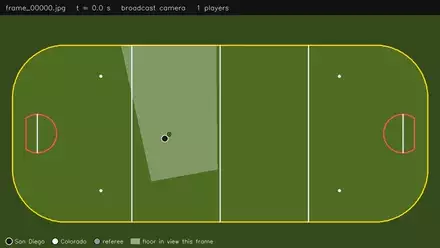
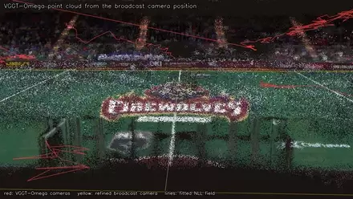
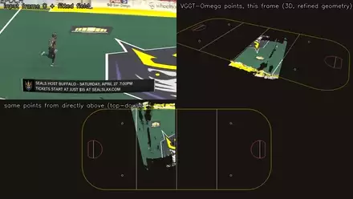
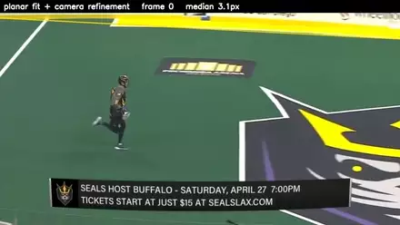

# Lacrosse SAM Tracking

3D reconstruction of NLL box-lacrosse broadcast clips:

- SAM3 segments the players.
- VGGT-Omega reconstructs the cameras and depth.
- The NLL field is fitted to the reconstructed floor plane, and the broadcast camera is refined against it.

The fitted scene drives 3D renders, SAM-Body4D player meshes and CoTracker player trajectories in field coordinates.

There are two clips: 10 s of San Diego at 10 fps, and 153 s of Week 1 (Toronto at Oshawa) at 1 fps.

## Videos

Click a preview to open the full H.264 video.

**Players on the fitted field.** Each player is a circle in their team's colour, placed through that frame's refined camera. The shaded area is the floor the camera sees in that frame.

| 10 s clip, San Diego | Week 1, Oshawa |
|---|---|
| [](docs/videos/clip10s_birds_eye.mp4) | [](docs/videos/week1_birds_eye.mp4) |

**VGGT-Omega point cloud on the fitted field.** The orbit ends in a top-down view. Yellow shows the refined broadcast camera, and red shows VGGT-Omega's own cameras.

| 10 s clip, San Diego | Week 1, Oshawa |
|---|---|
| [](docs/videos/clip10s_orbit.mp4) | [](docs/videos/week1_orbit.mp4) |

**Per frame.** Each frame shows the input with the fitted field, that frame's points in 3D, and the same points from above.

| 10 s clip, San Diego | Week 1, Oshawa |
|---|---|
| [](docs/videos/clip10s_timeline.mp4) | [](docs/videos/week1_timeline.mp4) |

**Fitted field drawn on the video.** The full videos show the rigid planar fit (top) and the fit after camera refinement (bottom).

| 10 s clip, San Diego | Week 1, Oshawa |
|---|---|
| [](docs/videos/clip10s_field_fit.mp4) | [](docs/videos/week1_field_fit.mp4) |

## How it works

1. **Segmentation and undistortion.** SAM3 text prompts segment `player`, `green field`, `white lines on green field` and `yellow outline around field border`. Radial lens distortion is estimated from the straightness of the white lines, and the frames and masks are undistorted.
2. **Reconstruction.** VGGT-Omega predicts per-frame cameras, depth and confidence.
3. **Landmark masks** (`build_field_paint_masks.py`). Painted lines, creases and the far board base are detected by colour. Each piece is labeled with its landmark, and the labels are checked by eye. Corrections are stored in `data/field_label_review/`.
4. **Field fit** (`fit_field_plane_landmarks.py`).
   - A plane is fitted to VGGT-Omega's floor points.
   - Landmark pixels are lifted onto that plane by ray–plane intersection.
   - A rigid similarity maps the plane to the NLL rulebook field (`field_model.py`).
   - The camera is then refined: one shared camera position, per-frame pan, tilt, roll and zoom, and the arena's corner radius.
   - Background points tracked between neighbouring frames tie each frame's camera to the measured image motion.
   - `camera_motion_check` in the fit summary lists frames where the fitted camera disagrees with that motion by more than 5 px.
   - Median reprojection error is 2.9 px on the 10 s clip and 1.8 px on Week 1.
   - [docs/field_plane_fit.md](docs/field_plane_fit.md) gives the method and the evidence.
5. **3D renders** (`render_vggt_scene_3d.py`). VGGT-Omega's points are placed through the refined cameras, so the floor paint lands on the fitted lines.
6. **Players on the field.**
   - Teams come from jersey brightness (`classify_sam3_teams_by_torso_color.py`), with per-track corrections checked by eye in `data/team_review/`.
   - `render_field_birds_eye.py` maps each player's foot point through that frame's homography in `field_homographies.json`.
   - Tracking glitches are replaced by interpolation along each player's track. These are points more than 4 ft off the track's running median, and whole frames where SAM3 shifted IDs between players. Gaps of up to 1 s are filled the same way.
7. **Meshes and trajectories.** SAM-Body4D meshes and CoTracker trajectories read VGGT-Omega through an export in the 518×518 VGGT layout.

## Setup

```bash
python -m pip install torch numpy scipy scikit-image opencv-python pillow imageio imageio-ffmpeg \
  transformers accelerate sam2 trimesh viser omegaconf tqdm
git clone https://github.com/facebookresearch/vggt-omega third_party/vggt_omega
git clone https://github.com/facebookresearch/vggt third_party/VGGT
git clone https://github.com/gaomingqi/sam-body4d third_party/sam-body4d
git clone https://github.com/facebookresearch/co-tracker third_party/co-tracker
python -m pip install -r third_party/vggt_omega/requirements.txt
export HF_TOKEN='your_huggingface_token'   # SAM3; never commit it
```

- **Checkpoint.** Put `vggt_omega_1b_512.pt` (gated, Hugging Face `facebook/VGGT-Omega`) under `checkpoints/vggt_omega/`.
- **Untracked files.** Source videos, frames, checkpoints, `third_party/` and `outputs/` stay local and are not tracked.
- **Import errors.** If Transformers fails to import because of `kernels`, run `pip uninstall -y kernels kernels-data`.

## Run

These commands are for Week 1; the 10 s clip's differences follow. [docs/week1_10fps_estimate.md](docs/week1_10fps_estimate.md) estimates the time and changes needed to run Week 1 at 10 fps.

```bash
export RAW=data/week1_112825_osh_tor_0820_1053_frames_1fps
export FRAMES=${RAW}_undistorted
export RAW_SAM3=outputs/sam3/week1_112825_osh_tor_0820_1053_1fps
export SAM3=${RAW_SAM3}_undistorted
export RUN=outputs/vggt_omega/week1_1fps_undistorted

# 1. frames and SAM3 masks
mkdir -p "$RAW"
ffmpeg -ss 00:08:20 -to 00:10:53 -i "data/Week 1/112825_osh_tor.mp4" -vf fps=1 "$RAW/frame_%05d.jpg"
for prompt in player 'green field' 'white lines on green field' 'yellow outline around field border'; do
  name=$(echo "$prompt" | cut -d' ' -f1-2 | tr ' ' '_')
  python scripts/run_sam3_text_chunked.py --frames-dir "$RAW" --text "$prompt" --fps 1 \
    --output "$RAW_SAM3/${name}_tracks_chunked.mp4" --mask-dir "$RAW_SAM3/${name}_label_masks_chunked" \
    --instance-mask-dir "$RAW_SAM3/${name}_instance_masks_chunked"
done

# 2. lens undistortion of frames and masks, then re-box the player detections
python scripts/undistort_clip_from_text_line_masks.py --frames-dir "$RAW" \
  --white-mask-dir "$RAW_SAM3/white_lines_instance_masks_chunked" --output-frames-dir "$FRAMES" \
  --calibration-json outputs/vggt/week1_112825_osh_tor_0820_1053_undistorted/lens_undistortion_text_masks.json \
  $(for n in player green_field white_lines yellow_outline; do echo --npz-mask-map "$RAW_SAM3/${n}_instance_masks_chunked:$SAM3/${n}_instance_masks_chunked"; done)
python scripts/rebox_sam3_json_from_instance_masks.py --source-json "$RAW_SAM3/player_tracks_chunked.json" \
  --instance-mask-dir "$SAM3/player_instance_masks_chunked" --frames-dir "$FRAMES" \
  --output-json "$SAM3/player_tracks_chunked_reboxed.json"

# 3. VGGT-Omega (about 45 s and 19 GB of GPU memory for 153 frames at 1280x720)
python scripts/run_vggt_omega_clip.py --frames-dir "$FRAMES" --output "$RUN/vggt_omega_predictions.npz"

# 4. landmark masks (labels proposed from a fit of the clip, then the checked review), then the field fit
python scripts/build_field_paint_masks.py --frames-dir "$FRAMES" --predictions "$RUN/vggt_omega_predictions.npz" \
  --player-mask-dir "$SAM3/player_instance_masks_chunked" --fit "$RUN/field_fit/field_plane_fit.json" \
  --review data/field_label_review/week1_1fps_undistorted.json --output-dir "$RUN/paint_masks"
python scripts/fit_field_plane_landmarks.py --predictions "$RUN/vggt_omega_predictions.npz" --frames-dir "$FRAMES" \
  --paint-masks "$RUN/paint_masks" --fps 1 --output-dir "$RUN/field_fit"

# 5. 3D videos
python scripts/render_vggt_scene_3d.py --predictions "$RUN/vggt_omega_predictions.npz" \
  --field-fit "$RUN/field_fit/field_plane_fit.json" --frames-dir "$FRAMES" --output-dir "$RUN/scene_3d" --timeline-fps 3

# 6. teams (jersey brightness plus the checked review), then players on the fitted field
python scripts/classify_sam3_teams_by_torso_color.py --classification-mode luma \
  --review data/team_review/week1_1fps_undistorted.json --frames-dir "$FRAMES" \
  --sam3-json "$SAM3/player_tracks_chunked_reboxed.json" --instance-mask-dir "$SAM3/player_instance_masks_chunked" \
  --output-json "$RUN/teams/teams.json" --output-video "$RUN/teams/teams_review_h264.mp4" --fps 1
python scripts/render_field_birds_eye.py --homographies "$RUN/field_fit/field_homographies.json" \
  --sam3-json "$RUN/teams/teams.json" --instance-mask-dir "$SAM3/player_instance_masks_chunked" --frames-dir "$FRAMES" \
  --output-video "$RUN/birds_eye/birds_eye_players_h264.mp4" --output-json "$RUN/birds_eye/birds_eye_players.json" \
  --fps 1 --trail-seconds 0 --team-names "black=Oshawa,white=Toronto"
```

To review the teams of a new clip, look at one crop per SAM3 track and write the corrections (`black`, `white`, `referee`, or `ignore` for the bench and stands) to a review JSON keyed by object id.

**Labeling a new clip.**

1. Bootstrap a fit from the SAM3 masks: `fit_field_plane_landmarks.py --landmark white_lines=... --landmark field_outline=... --detect-white-paint`.
2. Build the masks from that fit.
3. Look through `$RUN/paint_masks/review/sheet_*.jpg` and write the corrections to a review JSON.
4. Refit.

**10 s clip.** The mask build adds the purple end-zone turf. The fit adds the two SAM2-tracked faceoff dots, the only landmarks on the near side. To make them, click the dots with `floor_homography_annotator.py --landmark-set faceoff_corners`, then run `faceoff_clicks_to_sam2_prompts.py` and `track_sam2_clicks.py`.

```bash
RUN10=outputs/vggt_omega/clip10s_10fps_undistorted
DM=outputs/sam2/floor_features/sam2_faceoff_corner_instance_masks_undistorted
python scripts/build_field_paint_masks.py --frames-dir data/frames_10fps_undistorted \
  --predictions $RUN10/vggt_omega_predictions.npz --floor-colours green,purple \
  --player-mask-dir outputs/sam3/text/sam3_text_player_instance_masks_undistorted \
  --fit $RUN10/field_fit/field_plane_fit.json --review data/field_label_review/clip10s_10fps_undistorted.json \
  --output-dir $RUN10/paint_masks
python scripts/fit_field_plane_landmarks.py --predictions $RUN10/vggt_omega_predictions.npz \
  --frames-dir data/frames_10fps_undistorted --paint-masks $RUN10/paint_masks \
  --landmark faceoff_right_upper=$DM#6 --landmark faceoff_right_lower=$DM#7 --output-dir $RUN10/field_fit
S10=outputs/sam3/text
python scripts/rebox_sam3_json_from_instance_masks.py --source-json $S10/sam3_text_player_instances.json \
  --instance-mask-dir $S10/sam3_text_player_instance_masks_undistorted --frames-dir data/frames_10fps_undistorted \
  --output-json $S10/sam3_text_player_instances_reboxed_undistorted.json
python scripts/classify_sam3_teams_by_torso_color.py --classification-mode luma \
  --review data/team_review/clip10s_10fps_undistorted.json --frames-dir data/frames_10fps_undistorted \
  --sam3-json $S10/sam3_text_player_instances_reboxed_undistorted.json \
  --instance-mask-dir $S10/sam3_text_player_instance_masks_undistorted \
  --output-json $RUN10/teams/teams.json --output-video $RUN10/teams/teams_review_h264.mp4 --fps 10
python scripts/render_field_birds_eye.py --homographies $RUN10/field_fit/field_homographies.json \
  --sam3-json $RUN10/teams/teams.json --instance-mask-dir $S10/sam3_text_player_instance_masks_undistorted \
  --frames-dir data/frames_10fps_undistorted --output-video $RUN10/birds_eye/birds_eye_players_h264.mp4 \
  --output-json $RUN10/birds_eye/birds_eye_players.json --fps 10 --team-names "black=San Diego,white=Colorado"
```

**Players in the fitted scene.**

```bash
python scripts/export_vggt_omega_vggt_layout.py --predictions "$RUN/vggt_omega_predictions.npz" \
  --field-fit "$RUN/field_fit/field_plane_fit.json" --frames-dir "$FRAMES" --output-dir "$RUN/vggt_layout"
export VGGT_NPZ="$RUN/vggt_layout/vggt_predictions_compact.npz"
export FIELD_FIT="$RUN/vggt_layout/field_fit_vggt_layout.json"

# SAM-Body4D meshes, top-down review videos and the interactive viser viewer (http://127.0.0.1:8097)
PYOPENGL_PLATFORM=egl python scripts/run_sam_body4d_from_sam3_boxes.py --repo-root third_party/sam-body4d \
  --config third_party/sam-body4d/configs/body4d.yaml --frames-dir "$FRAMES" \
  --sam3-json "$SAM3/player_tracks_chunked_reboxed.json" --output-dir "$RUN/sam_body4d" \
  --output-video "$RUN/sam_body4d_overlay_h264.mp4" --render-mode overlay --fps 1
python scripts/render_sam_body4d_vggt_birds_eye.py --vggt-repo third_party/VGGT --vggt-json "$FIELD_FIT" \
  --vggt-npz "$VGGT_NPZ" --frames-dir "$FRAMES" --sam3-json "$SAM3/player_tracks_chunked_reboxed.json" \
  --mesh-root "$RUN/sam_body4d/mesh_4d_individual" --focal-root "$RUN/sam_body4d/focal_4d_individual" \
  --floor-mask-dir "$SAM3/green_field_instance_masks_chunked" \
  --text-green-mask-dir "$SAM3/green_field_instance_masks_chunked" \
  --text-yellow-mask-dir "$SAM3/yellow_outline_instance_masks_chunked" \
  --text-white-mask-dir "$SAM3/white_lines_instance_masks_chunked" \
  --output-dir "$RUN/fused_birds_eye" --min-depth-conf 1.0 --fixed-field-player-size --fps 1
python scripts/view_vggt_reconstruction.py --frames-dir "$FRAMES" --predictions "$VGGT_NPZ" \
  --floor-fit-json "$FIELD_FIT" --mesh-root "$RUN/sam_body4d/mesh_4d_individual" \
  --focal-root "$RUN/sam_body4d/focal_4d_individual" --conf-threshold 20 --fixed-field-player-size \
  --no-ground-meshes-to-field --port 8097

# CoTracker trajectories seeded from the SAM3 player masks, then rendered at the broadcast frame rate
python scripts/run_cotracker_vggt_player_trajectories.py --frames-dir "$FRAMES" \
  --sam3-json "$SAM3/player_tracks_chunked_reboxed.json" --player-mask-dir "$SAM3/player_instance_masks_chunked" \
  --vggt-npz "$VGGT_NPZ" --field-fit-json "$FIELD_FIT" --output-dir "$RUN/cotracker_trajectories" --fps 1 \
  --points-per-object 3 --min-object-frames 10 --min-depth-conf-percentile 20 \
  --require-sam3-presence --ignore-cotracker-visibility --disable-mask-gate
python scripts/render_cotracker_trajectories_source_fps.py \
  --trajectory-json "$RUN/cotracker_trajectories/cotracker_vggt_player_trajectories.json" \
  --output-dir "$RUN/cotracker_trajectories_source_fps" --input-fps 1 \
  --source-video "data/Week 1/112825_osh_tor.mp4" --source-start-sec 500 --duration-sec 153 --output-fps 60000/1001
```

The meshes and trajectories use the rigid planar fit. The refined per-frame cameras are available as image→field homographies in `field_fit/field_homographies.json`.

## Outputs

`outputs/vggt_omega/<clip>/` holds:

| path | contents |
|---|---|
| `vggt_omega_predictions.npz` | VGGT-Omega cameras, depth, confidence and colours |
| `paint_masks/` | labeled landmark masks, `labels.json` and review sheets |
| `field_fit/` | `field_plane_fit.json` (plane, similarity, refined cameras, field dimensions, errors), `field_homographies.json`, `field_reprojection_h264.mp4`, `landmarks_on_field.jpg` |
| `scene_3d/` | `vggt_scene_orbit_h264.mp4`, `vggt_scene_timeline_h264.mp4` |
| `teams/` | per-detection teams (`teams.json`) and a review video |
| `birds_eye/` | `birds_eye_players_h264.mp4` and per-frame player field positions |
| `vggt_layout/` | the 518×518 VGGT-layout export for the mesh and trajectory scripts |

All videos are H.264 (`yuv420p`) MP4s.

Two checks in the JSON outputs flag frames to look at, so a clip does not have to be watched in full:
- `camera_motion_check` in `field_plane_fit.json`: frames where the fitted camera disagrees with the tracked image motion by more than 5 px (clips at 4 fps or more).
- `cleaning` in `birds_eye_players.json`: frames where SAM3 shifted IDs between players, and how many points were dropped and interpolated.

## Scripts

| script | role |
|---|---|
| `run_sam3_text_chunked.py` | SAM3 text tracking in chunks |
| `undistort_clip_from_text_line_masks.py` | lens undistortion from the white-line masks |
| `rebox_sam3_json_from_instance_masks.py` | detection boxes from the undistorted masks |
| `run_vggt_omega_clip.py` | VGGT-Omega cameras and depth |
| `build_field_paint_masks.py` | colour-detected, labeled landmark masks and review sheets |
| `field_model.py` | NLL rulebook field: landmark distances, curves and drawing |
| `fit_field_plane_landmarks.py` | floor-plane field fit and broadcast-camera refinement |
| `render_vggt_scene_3d.py` | 3D orbit and per-frame timeline videos |
| `classify_sam3_teams_by_torso_color.py` | teams from jersey brightness, with the checked review applied |
| `render_field_birds_eye.py` | bird's-eye player video on the fitted field |
| `export_vggt_omega_vggt_layout.py` | 518×518 VGGT-layout export |
| `floor_homography_annotator.py`, `faceoff_clicks_to_sam2_prompts.py`, `track_sam2_clicks.py` | faceoff-dot clicks and their SAM2 tracking (10 s clip) |
| `run_sam_body4d_from_sam3_boxes.py` | SAM-Body4D meshes from SAM3 boxes |
| `render_sam_body4d_vggt_birds_eye.py`, `view_vggt_reconstruction.py` | meshes in the VGGT scene: top-down videos and `viser` viewer |
| `run_cotracker_vggt_player_trajectories.py`, `render_cotracker_trajectories_source_fps.py` | CoTracker trajectories in field coordinates, rendered at source fps |
| `run_cotracker_sourcefps_player_masks.py`, `view_cotracker_sourcefps_tracks.py` | CoTracker on source-fps SAM3 masks, `viser` viewer |

Shared helpers:
- `track_sam3_text.py` (run by `run_sam3_text_chunked.py`)
- `video_utils.py`, `nll_field_geometry.py`
- `run_vggt_birds_eye.py`, `render_birds_eye_locations.py` and `fit_floor_homography_from_feature_clicks.py` (geometry and drawing for the mesh and trajectory scripts)
- `undistort_clip_from_field_lines.py`
