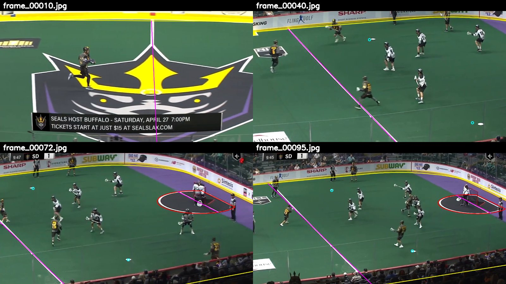
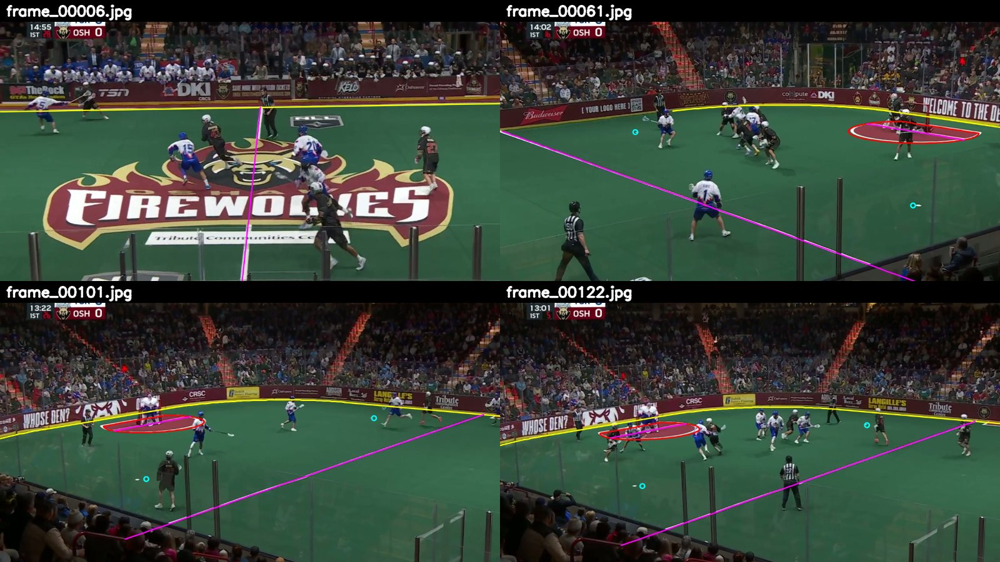
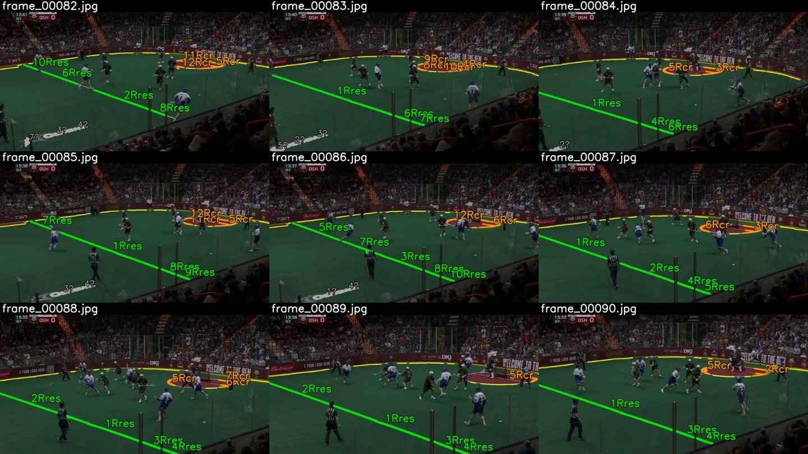
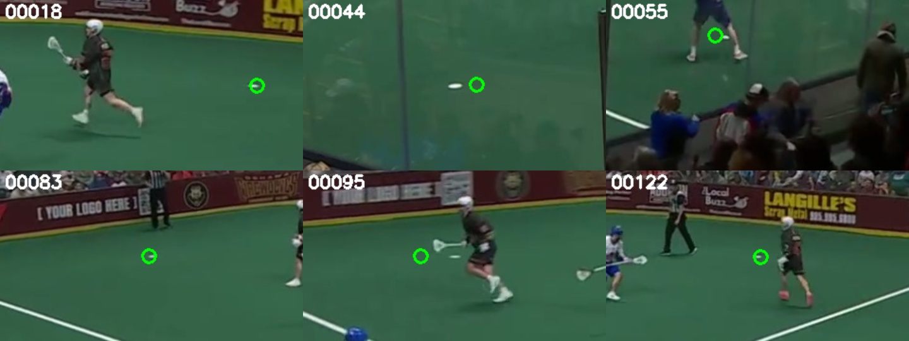

# Fitting the NLL field to VGGT-Omega through its floor plane

`scripts/fit_field_plane_landmarks.py` fits the NLL field to a VGGT-Omega reconstruction. It
replaces the depth-based VGGT field-fitting scripts (`fit_vggt_field_from_sam3_text_masks.py`,
`refit_vggt_field_with_sam2_faceoff_masks.py`, `fit_constrained_field_to_vggt_plane.py`,
`refit_vggt_field_with_goalie_anchor.py`, `refit_vggt_field_with_player_anchors.py`,
`refine_vggt_field_fit_from_point_clicks.py`, and the homography fit inside `run_vggt_birds_eye.py`).

The fit treats the VGGT-Omega reconstruction as what it is for a lacrosse floor: one plane
seen by one broadcast camera. Landmarks are fitted in that plane, and the camera is then
corrected against the known field. It needs three things to be right:

- **Landmarks that are what they claim to be.** These are painted lines and board edges, detected
  in every frame, labeled, and checked by eye (`scripts/build_field_paint_masks.py`).
- **A field model that matches the painted floor.** This is the NLL rulebook geometry, with the
  arena's corner radius estimated (`scripts/field_model.py`).
- **A camera model that matches a broadcast camera.** This is one camera position with
  per-frame pan, tilt, roll and zoom.

The 3D renders place VGGT-Omega's points through the same refined cameras, so the floor paint in
the top-down view lands on the fitted lines.

| clip | fit | median reprojection error | 90th percentile |
|---|---|---|---|
| 10 s, 10 fps | depth-based fit (goalie-anchor similarity) | 35.6 px | 160 px |
| | **plane fit** | **2.8 px** | **8.3 px** |
| Week 1, 1 fps | depth-based fit (huddle/goalie anchors, used by the SAM-Body4D fusion)\* | 9.4 px | 55 px |
| | **plane fit** | **1.8 px** | **5.4 px** |

Error is the image-space distance from every landmark pixel to the projected model curve of
*its own* landmark: midfield line, each restraining line, each crease, the far board base, and
for the 10 s clip the two SAM2 faceoff dots. Both fits are scored on the same checked masks, in
all frames.
\*The depth-based Week 1 fit has the two ends of the floor swapped. It is scored here with the
ends swapped back, in its favour; as fitted it is thousands of pixels off.




## Why depth-based fitting fails on broadcast footage

**1. Every frame's camera and depth are taken as exact.** Each mask pixel takes VGGT's depth at
that pixel, is unprojected to 3D, and is then dropped orthogonally onto one fitted plane.
Broadcast reconstructions are not consistent from frame to frame. In VGGT-Omega's reconstruction
of the 10 s clip, every frame's floor is very planar on its own (0.4% rms off-plane), but the floor
offset and the camera height drift by 14–24% across frames. Collected into one plane, the right
restraining line from different frames lands up to 11 ft apart: a band, not a line, with no
well-defined position to fit.

This is a camera problem as much as a depth problem. Casting rays through VGGT's own cameras
onto the plane gives the same spread. The per-frame cameras have to be corrected (stage 2
below), and that is only possible when lifting depends on the camera alone, not on depth.

**2. The reconstruction itself is projectively distorted.** For zoomed broadcast footage, VGGT
confuses zoom with dolly. In the 10 s clip, VGGT-Omega puts the camera about 290 ft from the play
with a 9° field of view, and slides it about 90 ft along its viewing direction while the operator
zooms. The refined camera is 180 ft away with a 17° field of view. A camera that is too far and
too telephoto flattens perspective. The reconstructed floor is then not a scaled copy of the real
one: it is compressed more on the far side than the near side. Because this distortion and the
frame-to-frame drift differ per frame, no single similarity, affine or plane homography can match
every landmark in every frame.

**3. Unlabeled nearest-curve matching on a periodic field.** The depth-based Week 1 fit matches
every white pixel to its nearest model line, using soft-L1 ICP. NLL lines repeat every 42.5 ft
(restraining, midfield, restraining), so a solution shifted by one spacing scores about as well as
the correct one. Its white-line model also contains full-width lines at x = 12 and 188 ft that are
not painted on an NLL floor; they act as extra attractors. Unlabeled lines also cannot tell the two
ends of the floor apart, and that fit has them swapped.

**4. Initialisation assumes the whole rink is visible.** Starting scales come from the bounding
box of observed points divided by 200 × 85 ft. A broadcast frame shows roughly half the floor, so
the starting scale and translation are wrong and the local optimiser stays in that basin.

**5. Mirror-image solutions are allowed.** The similarity search tries both reflections. A camera
looking down at the floor cannot see a mirrored rink, but unlabeled lines fit a mirror image just as
well. The similarity fit from `fit_constrained_field_to_vggt_plane.py` is mirrored and reprojects
318 px off.

**6. Free projective transforms in plane space.** An 8-DOF plane-to-field homography adds two
perspective degrees of freedom on a metric plane. With landmarks covering only part of the floor it
extrapolates wildly: the crease ends up about 1000 px off.

**7. Boards treated as floor.** The outline mask covers the vertical boards. Lifting all of its pixels
puts most of them far off the floor. Only the bottom edge, where the boards meet the turf, lies on
the field outline.

## How the fit works

### Landmark masks

Text- and click-prompted SAM masks are a poor landmark source. On Week 1, the SAM3 `white lines`
masks cover a fraction of the visible lines, and the `yellow outline` masks also cover the centre
logo. Neither says *which* line a pixel belongs to, so a midfield-line pixel can pull towards a
restraining line and nothing tells the two creases apart. On the 10 s clip, the SAM2 click-tracked
masks drift, and the outline mask covers the whole boards.

`scripts/build_field_paint_masks.py` detects the landmarks in the frame itself and labels them
explicitly:

1. **Floor.** Green turf by colour, plus purple end-zone turf where it touches the green floor
   (the San Diego arena). Seats and banners of the same colour are dropped because they are not
   connected to the floor.
2. **Paint candidates.** Thin, bright, unsaturated structures on the floor are found by a white
   top-hat filter. Players are removed with their SAM3 masks. Each connected piece is a candidate
   with a stable id.
3. **Far board base.** In each column, this is the first row of solid turf below non-turf: where
   the far boards meet the floor. It is smoothed across columns and dropped next to players and
   next to paint (a crease touching the boards). It is also dropped where a thick yellow band
   marks a bench's line-change area rather than the kick plate.
4. **Labels.** Each candidate is proposed the landmark whose projected curve it lies on under a
   fit of the clip (`--fit`). A proposal needs the projected curve to be close and unambiguous.
   For a line it also needs a straight piece running in the projected line's direction. Logo
   artwork next to the midfield line fails that test.
5. **Review by eye.** Every frame of both clips is checked on the review sheets the script
   writes (`paint_masks/review/sheet_*.jpg`; the figure below is one of them).
   - Corrections are kept in `data/field_label_review/*.json`, keyed by frame and candidate id.
   - Week 1 has 37 corrections in 17 of 153 frames. These are mostly restraining-line pieces
     the proposal misses, and pieces in close-ups that cannot be confirmed and are set to
     unlabeled.
   - The 10 s clip has 36 corrections in 34 of 100 frames. These are mostly the zoomed frames at
     the start, where the midfield line shows only as a short stub between the boards and the logo.
   - Proposed from the final fit, 941 of the 942 labeled pieces keep their label. The final fit
     also proposes 10 Week 1 pieces that the review keeps unlabeled (stick shafts, logo artwork
     and close-ups behind the crease).



The landmarks are per side and per type: `midfield_line`, `left/right_restraining_line`,
`left/right_crease_lines` (the crease arc, its straight back and the goal line across it), and
`board_base`.

The near boards are not used. The broadcast camera looks over them, so the visible turf ends at
their top edge, about 4 ft up, not at the floor. Logos and floor ads that reach the bottom of the
image produce the same kind of edge. With these edges in the fit, the 10 s camera moves to 245 ft
behind the sideline and 20 of 100 frames become `unreliable`.

### Field model

`scripts/field_model.py` follows the NLL rulebook (2019-20, rules 1.5, 2.1, 3.1 and 6.2), and its
distances are analytic.

- **No centre faceoff circle.** Neither arena paints one: both have a team logo there.
  `--centre-circle-radius-ft` adds one for an arena that does.
- **The crease as painted.** A 9 ft 3 in arc centred on the goal-line midpoint, a straight back
  5 ft 6 in behind the goal line (1 ft behind the 4 ft 6 in goal base), and the goal line painted
  across the full crease.
- **Goals tied to the end boards.** The goal lines are 12 ft from the end boards, the restraining
  lines 42 ft 6 in from the centre line, and the corner faceoff spots 15 ft from the side boards
  and 15 ft outside the restraining lines.
- **The corner radius is estimated per arena.** The boards are those of the hockey rink under
  the floor, and rinks differ. The radius is a parameter of the camera refinement, with a soft
  prior towards 22 ft 8 in. The fit puts it at 25.2 ft in San Diego and 26.9 ft in Oshawa. The
  85 ft width stays fixed as the scale.
- **The floor length is fixed at the 200 ft rink standard.** No frame shows both ends, so the
  length trades off against camera distance and zoom. Freed on the 10 s clip with the faceoff dots
  left out, it goes to 209 ft, and the dots land 1.5 and 3.1 ft off, against 1.1 and 2.4 ft with
  the length fixed. `--estimate-dims half_length,corner_radius` frees it as a diagnostic.
- The fitted dimensions are written as `field_dims` in `field_plane_fit.json` and
  `field_homographies.json`. Every overlay and the 3D renders draw the field with them.

### Stage 1: a rigid planar fit

1. **Floor plane.** Fit a RANSAC plane, then polish it with least squares, on confident VGGT-Omega
   depth points on green turf. Players and boards are excluded by colour. The normal is oriented
   towards the cameras.
2. **Ray–plane lifting.** Every landmark pixel is lifted by intersecting its camera ray with that
   single plane. Per-pixel depth is never used, so depth noise cannot smear the landmarks, and each
   lifted point depends on the camera alone. That is what lets stage 2 correct the cameras.
3. **Landmark-specific observations.**
   - Painted lines, crease lines and board-base pixels from `build_field_paint_masks.py` use every
     pixel.
   - Other mask sources are accepted with `--landmark`:
     - a filled crease mask uses its outline;
     - a boards or kick-plate mask uses its bottom edge, kept only where turf lies directly below;
     - faceoff dots use one centroid per frame.
4. **Proper similarity, global search, robust refinement.** Plane coordinates map to field feet by
   scale, rotation and translation, never a mirror.
   - **Start.** A brute-force distance-transform search over rotation, scale and translation. The
     scale range comes from a physical prior: a broadcast camera is 20–120 ft above the floor. If
     two or more faceoff dots are visible, their closed-form similarity is added as a candidate.
   - **Refinement.** Every candidate is refined with soft-L1 loss in plane units (observation
     space), and the lowest robust cost wins.

### Stage 2: camera refinement against the planar field

The stage-1 transform puts VGGT-Omega's cameras in field feet. The model then becomes what a
broadcast camera physically is:

- **One shared camera centre** for the clip.
- **Per-frame pan, tilt, roll and zoom corrections**, bounded to 20° and a factor of 2.
- **The arena's corner radius**, shared by all frames, with a soft prior.
- **Priors**: a weak pull towards VGGT-Omega's own per-frame pointing, plus smoothness between
  neighbouring frames. Smoothing is switched off across broadcast cuts.

Several starting centres are tried, from VGGT's centre to points much closer to the floor it looks
at. Moving the centre re-aims every camera at the same floor point and rescales its focal length,
which undoes VGGT's zoom-as-dolly motion. Residuals are floor distances divided by the local
feet-per-pixel, which approximates image pixels.

Frames the shared camera cannot explain (cuts to another camera) are dropped from the shared fit and
refitted with their own camera. If that still fails, they are flagged `unreliable` and left out of the
exported homographies.

### 3D placement

`render_vggt_scene_3d.py` places VGGT-Omega's points through the refined cameras:

- Each pixel goes on its refined camera's ray, at the height that VGGT-Omega gives it above that
  frame's own floor. VGGT-Omega's floor height drifts between frames, so a plane is fitted to
  each frame's turf points, and heights under 1 ft are snapped to the floor.
- Floor pixels land on z = 0, so the floor paint of every frame lands on the fitted lines.
- Players and boards keep VGGT-Omega's heights.
- Points too high for that, the crowd above the camera, keep VGGT-Omega's distance, rescaled per
  frame.
- The accumulated orbit cloud uses the frames the shared broadcast camera explains. Close-ups
  with their own camera and frames without landmarks are left out of it; the per-frame timeline
  shows every frame and labels its status.

`--geometry raw` maps VGGT-Omega's own points with the rigid plane transform instead. It shows the
reconstruction as VGGT-Omega made it: the telephoto distortion and frame-to-frame drift
described above, with a skewed logo and paint doubled where frames disagree.


## Evidence that the fit is right

Positions of each landmark's pixels on the field, through the refined cameras:

| landmark | model | 10 s clip | Week 1 |
|---|---|---|---|
| left restraining line | x = 57.5 ft | 57.50 ft (IQR 0.26) | 57.50 ft (IQR 0.28) |
| midfield line | x = 100 ft | 100.00 ft (IQR 0.32) | 99.98 ft (IQR 0.21) |
| right restraining line | x = 142.5 ft | 142.47 ft (IQR 0.28) | 142.50 ft (IQR 0.29) |
| creases (circle fit) | centre x = 12 / 188 ft, r = 9.25 ft | 187.9 ft, r 8.8 | 11.6 / 188.2 ft, r 9.1 / 9.0 |
| far board base | rounded outline | median 0.42 ft off | median 0.64 ft off |
| faceoff dots | (157.5, 70) / (157.5, 15) | (157.5, 70.5) / (157.8, 15.0) | not visible |

Crease radii are measured to the centre of a 5 in line.

- **Held-out faceoff dots (10 s clip).** The dots are the only near-side landmarks in this clip, so
  each is held out in turn:
  - With only the upper dot in the fit, the lower dot lands 0.7 ft from its spot.
  - With only the lower dot in the fit, the upper dot lands 1.35 ft from its spot.

  The fit uses both. Without any dot, nothing fixes the near side. Camera distance then trades
  against zoom, and the near dot drifts by about 3 ft while every far-side landmark still fits.
- **Held-out faceoff dots (Week 1).** No faceoff dot is used in the Week 1 fit. The painted dots
  are found by colour within 90 px of where the fit projects them: 171 detections in which exactly
  one small white blob lies near the projected spot. Lifted through the fit, they land 0.71 ft
  from their rulebook spots (median; 90th percentile 1.6 ft; 13 px in the image).

  
- **Camera position.**
  - 10 s clip: the recovered camera is 113 ft behind the near sideline and 50 ft up, level with
    centre floor. VGGT-Omega's own estimate is 216 ft back and 75 ft up.
  - Week 1: the camera is 34 ft behind the near sideline and 20 ft up, with a 36° field of view.
    148 of 153 frames fit this shared camera, 4 (cuts and close-ups) have their own camera, 1 has
    no visible landmarks, and none are flagged `unreliable`.
- **Per landmark** (median / 90th percentile px):

  | landmark | 10 s clip | Week 1 |
  |---|---|---|
  | midfield line | 4.6 / 9.1 | 2.5 / 5.2 |
  | left restraining line | 3.1 / 5.4 | 1.5 / 3.0 |
  | right restraining line | 2.9 / 6.8 | 1.8 / 4.3 |
  | left crease | not visible | 1.9 / 5.2 |
  | right crease | 3.1 / 11.1 | 2.4 / 6.9 |
  | far board base | 2.4 / 9.3 | 1.8 / 10.4 |
  | faceoff dots (upper / lower) | 5.7 / 10.2, 7.7 / 20.9 | not used |

## Running it

```bash
python scripts/run_vggt_omega_clip.py --frames-dir "$FRAMES" --output "$RUN/vggt_omega_predictions.npz"

# 1. landmark masks: detect paint and board edges, propose labels from a fit of the clip,
#    apply the checked review, write review sheets
python scripts/build_field_paint_masks.py --frames-dir "$FRAMES" --predictions "$RUN/vggt_omega_predictions.npz" \
  --player-mask-dir "$SAM3/player_instance_masks_chunked" --fit "$RUN/field_fit/field_plane_fit.json" \
  --review data/field_label_review/week1_1fps_undistorted.json --output-dir "$RUN/paint_masks"
#    (10 s clip: add --floor-colours green,purple)

# 2. field fit (10 s clip: also --landmark faceoff_right_upper=$DOTS#6 --landmark faceoff_right_lower=$DOTS#7)
python scripts/fit_field_plane_landmarks.py --predictions "$RUN/vggt_omega_predictions.npz" --frames-dir "$FRAMES" \
  --paint-masks "$RUN/paint_masks" --fps 1 --output-dir "$RUN/field_fit"
```

**Labeling a new clip.**

1. Bootstrap. Any fit of the clip can propose labels. On a new clip, run `fit_field_plane_landmarks.py`
   once on SAM masks (`--landmark white_lines=... --landmark field_outline=... --detect-white-paint`),
   or run `build_field_paint_masks.py` without `--fit`, in which case every candidate starts unlabeled.
2. Review. Look through `paint_masks/review/sheet_*.jpg`. Write corrections as
   `{"frame_00077.jpg": {"4": "right_restraining_line", "9": "reject"}, ...}`; `"board_base": "reject"`
   drops a frame's board edge.
3. Repeat. Rebuild the masks, refit, and propose again from the refit until the proposals stop
   changing.

**Options.**

- `--estimate-dims none` keeps the rulebook floor exactly.
- `--estimate-dims corner_radius,crease_radius,...` frees more dimensions as a check against
  the rulebook.
- `--centre-circle-radius-ft` draws and fits a centre faceoff circle, for arenas that paint one.

Outputs in `--output-dir`:

- `field_plane_fit.json`: the plane, the plane→field similarity, the fitted `field_dims`, per-frame
  cameras in field feet (rigid and refined), per-landmark and per-frame errors, landmark positions
  and frame status.
- `field_homographies.json`: per-frame image→field homographies in the `floor_homography_matrix_v1`
  schema, with `field_dims`. This is the recommended way to map player foot pixels to the field;
  `render_field_birds_eye.py` uses it for the bird's-eye player videos.
- `field_reprojection_h264.mp4`: every frame with the rigid fit (top) and the refined fit (bottom) drawn on it.
- `landmarks_on_field.jpg`: stage-1 lifted landmarks on the field diagram.

`scripts/export_vggt_omega_vggt_layout.py` writes the reconstruction and the rigid fit in the
518×518 VGGT layout (`vggt_predictions_compact.npz` and `field_fit_vggt_layout.json`). The
depth-based consumers (`render_sam_body4d_vggt_birds_eye.py`, `view_vggt_reconstruction.py` and
`run_cotracker_vggt_player_trajectories.py`) then run unchanged on VGGT-Omega. They get the stage-1
rigid fit and the standard 200 × 85 ft drawing only; the per-frame camera refinement and the fitted
dimensions are available only through `field_homographies.json`.

`scripts/render_vggt_scene_3d.py` renders the VGGT-Omega point cloud on the fitted field:

- an orbit that ends in a top-down view
- a per-frame timeline: the input frame with the fitted field, an oblique 3D view and a top-down
  view

Points are placed through the refined cameras by default (see 3D placement above).

## Limitations

- **Near side of the floor.** Broadcast views rarely show painted marks near the near boards.
  Their geometry rests on the camera model and, in the 10 s clip, on the two faceoff dots.
  Without them, camera distance and zoom trade off, as described above.
- **Floor length.** The length is assumed to be the 200 ft rink standard.
- **Label review is done by eye.** It holds for these two clips. A new clip needs its own review
  pass, usually short once a bootstrap fit exists.
- **End symmetry.** On a clip where no landmark tells the ends apart, the solution is only fixed up
  to the field's 180° symmetry. Labeled creases and restraining lines remove this.
- **Moving cameras.** Stage 2 assumes the main broadcast camera stays in one place. Clips that
  mostly come from moving cameras need more frames flagged `own_camera`, and those frames are less
  constrained. Check the `status` field before trusting one.
- **Zoomed close-ups.** In a tight close-up that shows only the midfield stub and the far
  boards, zoom and tilt are only weakly separated. On Week 1, frames of the opening faceoff place
  the centre logo up to about 5 ft apart along the camera's viewing direction. The logo is
  therefore smeared in the accumulated top-down cloud, while every painted line is sharp.
- **Refined 3D placement.** Placing points through the refined cameras uses VGGT-Omega's heights
  above the floor. Players and boards are therefore as tall as VGGT-Omega makes them, and crowd
  points above the camera keep VGGT-Omega's distances.
